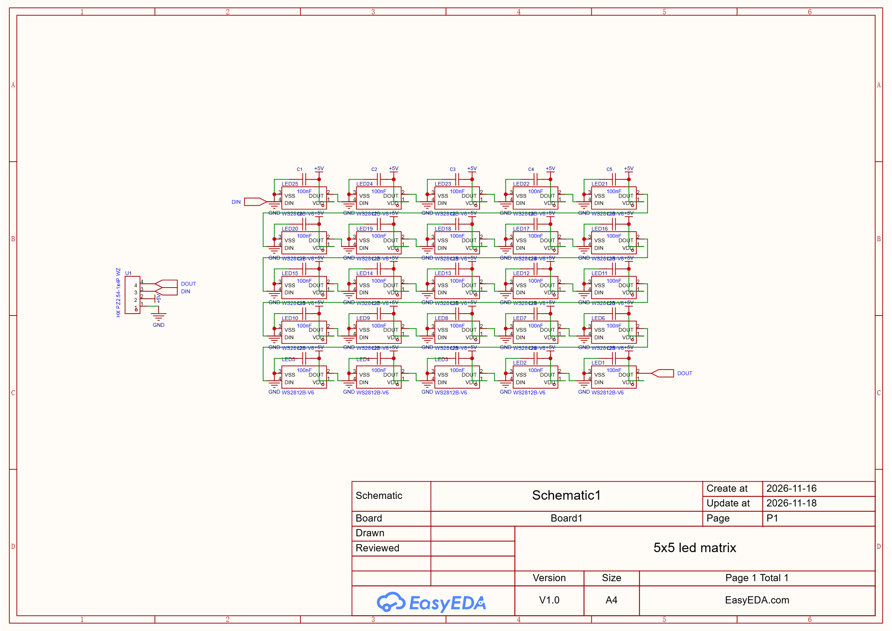

# 5x5-led-matrix

**A DIY 5x5 RGB LED matrix on a custom 2-layer PCB, using 25 WS2812B-V6 addressable LEDs**


##  Overview

**What is this?**

A DIY 5x5 RGB LED matrix: a small custom PCB with 25 individually addressable WS2812B-V6 LEDs. You control each pixel's color from a microcontroller over a single data wire, so it can show animations, simple icons, status indicators or mood lighting.


## Cost 


| Name          | Description                                                                   | Price  | Shipping+tariff |
| ------------- | ----------------------------------------------------------------------------- | ------ | -------- |
| Componenets+Assembly   | Components from LCSC. Detailed breakdown [here](/BOM_5x5.xlsx)       | $52.74 |   $13.55 |
| PCB   | PCB  from JLC                                                                         | $2.00  |  $13.24  |
| **Sub Total** |                                                                               | $54.74 |  $26.79  |
| **Total**     |                                                                               | $81.53 |          |
| **Total with discount(-$31.74)**     |                                                                 | $49.79 |          |

Full breakdown of the bom [here](/BOM.csv.xlsx)


## Schematics

**This project was made on EasyEDA**





## Repo structure

```
├── EasyEDA/      EasyEDA file
├── BOM/          BOM file
├── Gerber/       Gerber file
├── PickAndPlace/ PickAndPlace file
├── schematics/   Schematic image
├── Firmware/     Firmware
└── images/       photos and renders

```
